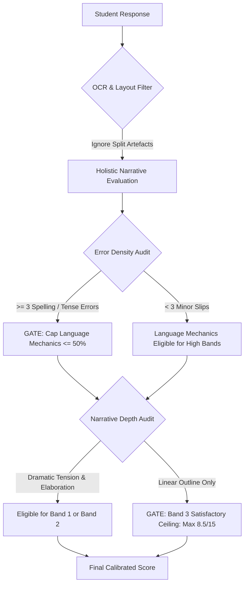

# NCTB Standard Analytical Evaluation Rubric & Teacher Validation Protocol
## An Assessment Framework for Multimodal Automated Essay Scoring (AES) in Secondary English

**Author/Project**: Undergraduate Thesis: *Script Checking With Multimodal AI*  
**Curriculum**: National Curriculum and Textbook Board (NCTB), Bangladesh  
**Subject**: English (First & Second Paper — Classes 6, 7, 8, and SSC Class 10)  
**Target Audience**: Academic Evaluators, Thesis Defense Committee, External Human Raters (English Teachers)  

---

## 1. Executive Summary & Problem Formulation

### 1.1 The Model Leniency Problem ("Checklist Bias")
In preliminary baseline evaluations using multimodal large language models (MLLMs) for handwritten script evaluation, a critical failure mode emerged: **extreme score inflation and checklist leniency**.

A benchmark instance is observed in **Question 10 (Story Writing, 15 marks)** of SSC Class 10 (`SE_10_Q1_0001`):
- **Student Performance**: The candidate produced a brief, simple linear narrative (~115 words) based on the fable prompt (*"A thirsty crow..."*). The composition featured only 1 sentence of resolution, contained 3 explicit spelling errors (`suffuring`, `retured`, `beuty`), and displayed repetitive elementary sentence patterns.
- **Human Senior Examiner Score**: **7.5 / 15.0** (50.0% — *Satisfactory / Average*).
- **Unconstrained Baseline LLM Score**: **14.5 / 15.0** (96.7% — *Near Perfect*).

**Root Cause**: LLMs default to "checklist completion." If the student wrote a title, had a beginning, middle, and end, and did not write offensive content, the prompt rewarded almost maximum marks across criteria because it lacked **qualitative depth descriptors** and **hard error-density ceilings**.

### 1.2 The Length Bias Trap (Word Count vs. Qualitative Elaboration)
A second major pitfall in automated essay scoring is **Length Bias** (scoring additively on volume rather than substance). 
- In naive systems, longer scripts receive higher marks regardless of content vacuity, while concise, sharply written compositions are penalized.
- Conversely, awarding full marks to a 100-word piece simply because it fulfilled the superficial prompt outline ignores whether the student actually developed characterization, conflict, dialogue, or figurative language appropriate for Grade 10.

**The Solution**: We adopt **Feature-Based Narrative & Dialogic Elaboration**:
1. Word count is treated strictly as an empirical lower bound (sanity check) — e.g., an SSC narrative cannot develop tension in under 50 words.
2. Marks are awarded based on **narrative depth, thematic tension, vocabulary breadth, and syntactic maturity**, rather than character accumulation.

---

## 2. Pedagogical Grounding: The 4-Trait Analytic Framework

To eliminate subjective halo effects and align with both **NCTB Curriculum Objectives** and international benchmarks (**Cambridge English / CEFR B1/A2 Writing Scales**), all continuous writing tasks (Mode C) are evaluated across four orthogonal criteria:

```
+-----------------------------------------------------------------------------------+
|                        TOTAL COMPOSITION SCORE (100%)                             |
+-------------------------+-------------------------+---------------+---------------+
|       Trait 1           |       Trait 2           |    Trait 3    |    Trait 4    |
|   Content & Narrative   |   Organization &        |  Language &   |  Originality  |
|       Elaboration       |      Cohesion           |  Mechanics    | & Expression  |
|     (33.3% - 35%)       |   (25.0% - 28.5%)       | (25.0% - 28%) | (10% - 13.3%) |
+-------------------------+-------------------------+---------------+---------------+
```

### Trait 1: Content & Narrative Elaboration (`context_content_data`)
- **Focus**: Task fulfillment, thematic relevance, plot progression, character motivation, and crisis resolution (or for dialogues: topic exploration, authentic conversational turns, realistic viewpoints).
- **Diagnostic Question**: *Did the student tell a genuine story with development and resolution, or merely produce a factual outline?*

### Trait 2: Organization & Coherence (`organization_cohesion`)
- **Focus**: Logical sequence, narrative pacing, appropriate transitional linkers (*meanwhile, subsequently, suddenly, consequently*), paragraph structure, and overall unity.
- **Diagnostic Question**: *Does the piece flow naturally from exposition to climax, or does it jump erratically between disconnected sentences?*

### Trait 3: Language Mechanics & Syntactic Maturity (`language_mechanics`)
- **Focus**: Tense consistency (especially narrative past vs. present), subject-verb agreement, lexical spelling accuracy, punctuation, and syntactic variety (simple vs. compound vs. complex clauses).
- **Diagnostic Question**: *Are sentences grammatically sound, or do repeated morphological slips and spelling blunders impede fluent reading?*

### Trait 4: Originality & Lexical Resource (`originality_comparisons_paraphrase`)
- **Focus**: Vocabulary range, vivid sensory adjectives/verbs, avoidance of bland clichés, natural dialogue idioms, creative twists, and fresh phrasing.
- **Diagnostic Question**: *Does the writing exhibit linguistic spark and creative flair beyond routine textbook memorization?*

---

## 3. Standard Performance Bands & Descriptors

Every composition must fall holistically within a defined performance band. The subscore sum must strictly reflect the qualitative realities of that band.

### 3.1 15-Mark Continuous Tasks (SSC Class 10: Story & Dialogue)

| Band | Label | Score Range | Content & Depth | Organization & Cohesion | Language & Mechanics | Originality & Lexicon |
| :---: | :---: | :---: | :--- | :--- | :--- | :--- |
| **Band 1** | **Excellent** | **12.0 – 15.0** | Rich, compelling plot arc with tangible dramatic tension, distinct character traits, and satisfying resolution. | Seamless transitions; sophisticated paragraphing and pacing; effortless narrative flow. | Near-flawless past-tense control; varied sentence structures (complex/compound); 0–1 minor mechanical slips. | Vivid sensory imagery; ambitious, precise vocabulary; natural dialogic nuance. |
| **Band 2** | **Good** | **9.0 – 11.5** | Clear narrative development beyond prompt; recognizable conflict and clear resolution. | Logical progression; appropriate transitional markers; coherent structural units. | Generally sound grammar; occasional minor slips that do not impede clarity; consistent tense. | Good vocabulary variety; appropriate idioms; minor repetition. |
| **Band 3** | **Satisfactory (Average Baseline)** | **6.0 – 8.5** | Predictable, linear sequence of events; basic fulfillment of the prompt outline; minimal character or emotional depth. | Basic sequence of events; relies on elementary connectives (*and, then, after that, so*). | Noticeable spelling errors (2–4 mistakes) or inconsistent tense switching; simple sentence patterns predominate. | Routine, predictable vocabulary; textbook clichés; minimal descriptive adjectives. |
| **Band 4** | **Limited** | **3.0 – 5.5** | Abrupt, truncated, or incomplete storyline; crucial plot points omitted or unresolved. | Disjointed or chaotic ordering; sudden leaps without transitions; poor paragraph cohesion. | Frequent grammatical breakdowns; pervasive spelling slips; meaning often clouded or ambiguous. | Extremely narrow vocabulary; heavy repetition of basic words. |
| **Band 5** | **Poor / Inadequate** | **0.0 – 2.5** | Fragmentary, largely off-topic, or unintelligible attempt. | No discernible logical progression; isolated sentence fragments. | Pervasive grammatical breakdown; unreadable sentence structures. | Severely deficient lexicon; unable to express basic thoughts in English. |

---

### 3.2 10-Mark Continuous Tasks (Summary, Paragraph, Junior Story)

| Band | Label | Score Range | Performance Characteristic |
| :---: | :---: | :---: | :--- |
| **Band 1** | **Excellent** | **8.0 – 10.0** | Comprehensive coverage of core themes; completely in student's own words; highly cohesive flow; sophisticated grammar. |
| **Band 2** | **Good** | **6.0 – 7.5** | Covers all essential points; clear logical structure; minimal direct copying; occasional minor slips. |
| **Band 3** | **Satisfactory** | **4.0 – 5.5** | Captures partial core ideas; noticeable verbatim lifting or repetitive phrasing; simple syntax; basic comprehension evident. |
| **Band 4** | **Limited** | **2.0 – 3.5** | Heavy copying (>40%); omits pivotal concepts; frequent grammatical breakdowns obscuring meaning. |
| **Band 5** | **Poor** | **0.0 – 1.5** | Wholesale verbatim lifting, incoherent fragments, or completely off-topic. |

---

## 4. Rigorous Gating Rules & Anti-Bias Safeguards

To prevent LLM drift and ensure strict psychometric fairness, the pipeline applies hard evaluation gates:



### 4.1 Error-Density Gating Rule
* **Principle**: In human grading, spelling and morphological mastery are hygiene factors. A script cannot be awarded an "A+" (Band 1: >80%) if basic words are misspelled.
* **Gate**: If a student script contains **3 or more distinct spelling mistakes** (e.g., `suffuring`, `retured`, `beuty`) or persistent tense shifts (switching indiscriminately between past and present narrative voice), `language_mechanics` is **strictly capped at or below 50% of its criterion ceiling** (e.g., max 2.0 / 4.0 in Class 10).
* **Direct Consequence**: A script with persistent spelling errors can mathematically **never exceed 11.0 / 15.0**, instantly preventing the 14.5/15 anomaly.

### 4.2 Narrative Elaboration Gating Rule
* **Principle**: Simply providing a bare chronological chain of events does not constitute creative story writing at the SSC level.
* **Gate**: A bare-bones linear narrative (~100–130 words) that merely connects standard fable steps without internal dialogue, dramatic suspense, descriptive adjectives, or original resolution is permanently calibrated to **Band 3: Satisfactory (6.0 – 8.5 marks)**.

### 4.3 Verbatim Overlap Hard Cap (Mode C Summaries)
* **Threshold**: If n-gram analysis reveals $\ge 50\%$ verbatim overlap with the comprehension passage, the total awarded mark is **hard-capped at 3.0 / 10.0** (`max_awarded: 3.0`).

### 4.4 OCR Robustness Guarantee
* **Safeguard**: Physical line breaks, unintended paragraph splits, or margin indentations resulting from document scanning or handwriting OCR segmentations are explicitly filtered out. Raters and models grade **conceptual cohesion**, not image extraction artefacts.

---

## 5. Grade-Level Calibration Across Classes

The rubrics reflect progressive developmental milestones from Class 6 through Class 10:

| Class Level | CEFR Level | Primary Task Types | Criteria Ceilings Breakdown | Developmental Expectation |
| :--- | :---: | :--- | :--- | :--- |
| **Class 6** | **A1 $\to$ A2** | Summary (5m), Story (10m), Paragraph (10m), Dialogue (10m) | **Content: 3.5 \| Org: 2.5 \| Lang: 2.5 \| Orig: 1.5** (10m)<br>**Content: 2.0 \| Org: 1.5 \| Lang: 1.5** (5m) | Age-appropriate leniency for 11–12 year olds. Prioritize communicative intent over minor agreement slips. |
| **Class 7** | **A2** | Summary (5m), Story (10m), Paragraph (10m), Dialogue (10m) | **Content: 3.5 \| Org: 2.5 \| Lang: 2.5 \| Orig: 1.5** (10m)<br>**Content: 2.0 \| Org: 1.5 \| Lang: 1.5** (5m) | Expect developing compound sentences and clear sequence connectives (*first, next, then, finally*). |
| **Class 8** | **A2+** | Summary (10m), Story (7m), Paragraph (7m), Dialogue (6m) | **Story/Para (7m): Content: 2.5 \| Org: 2.0 \| Lang: 2.0 \| Orig: 0.5**<br>**Dialogue (6m): Content: 2.0 \| Org: 2.0 \| Lang: 1.5 \| Orig: 0.5** | Expect clear paragraph unity and correct conversational turn-taking with appropriate register. |
| **Class 10 (SSC)** | **B1** | Summary (10m), Story (15m), Dialogue (15m) | **Story/Dial (15m): Content: 5.0 \| Org: 4.0 \| Lang: 4.0 \| Orig: 2.0**<br>**Summary (10m): Content: 4.0 \| Org: 3.0 \| Lang: 2.0 \| Orig: 1.0** | Formal secondary examination standard. Rigorous grammar, narrative depth, tense consistency, and vocabulary breadth. |

---

## 6. Teacher Evaluation Protocol (Ground-Truth Validation)

To validate the MLLM grading against expert human standards for the undergraduate thesis, we establish a standardized **Double-Blind Evaluation Experiment**.

### 6.1 Experimental Design
1. **Sample Size**: 30–50 representative student scripts across Classes 6, 7, 8, and 10.
2. **Blinded Conditions**:
   - The Teacher evaluates the original handwritten scripts (or high-resolution transcription) using this standard analytical rubric.
   - The Teacher does **not** see the LLM's scores or feedback.
   - The LLM evaluates the verified transcriptions independently.
3. **Statistical Metrics for Thesis Defense**:
   - **Quadratic Weighted Kappa (QWK)**: Measures inter-rater agreement on ordinal/continuous scales, heavily penalizing wide discrepancies. Target: $\text{QWK} \ge 0.70$ (substantial agreement).
   - **Pearson Correlation ($r$) & Spearman Rank Correlation ($\rho$)**: Measures linear score alignment and ranking consistency. Target: $r \ge 0.80$.
   - **Mean Absolute Error (MAE)**: Measures average point distance between Model and Teacher. Target: $\text{MAE} \le 1.25$ marks on a 15-mark task.
   - **Intraclass Correlation Coefficient (ICC [2,1])**: Two-way random effects model measuring absolute agreement across raters.

### 6.2 Standard Teacher Scorecard Sheet

For each script, the human evaluator records scores using this exact breakdown:

```markdown
### SCRIPT EVALUATION SCORECARD
- **Script ID**: _________________________   **Class Level**: [ ] 6  [ ] 7  [ ] 8  [ ] 10
- **Question Number**: ____________________   **Task Type**: [ ] Story  [ ] Summary  [ ] Dialogue  [ ] Paragraph
- **Maximum Marks**: _____________________

| Criterion | Max Ceiling | Marks Awarded | Justification / Specific Evidence |
| :--- | :---: | :---: | :--- |
| **1. Content & Narrative Elaboration** | _____ | _____ | |
| **2. Organization & Cohesion** | _____ | _____ | |
| **3. Language Mechanics & Syntax** | _____ | _____ | |
| **4. Originality & Lexical Resource** | _____ | _____ | |
| **TOTAL RAW SCORE** | **100%** | **_____** | |

- **Assigned Holistic Band**: 
  [ ] Band 1: Excellent   [ ] Band 2: Good   [ ] Band 3: Satisfactory   [ ] Band 4: Limited   [ ] Band 5: Poor
- **Identified Linguistic Errors**: ___________________________________________________________
- **Overall Examiner Remarks**: ______________________________________________________________
```

---

## 7. Conclusion & Thesis Contribution
By deploying this 4-trait analytical rubric with explicit qualitative performance bands and error-density gating, our multimodal evaluation architecture eliminates the historical "14.5/15 leniency flaw." It provides an academically defensible, pedagogical, and psychometrically sound foundation for automating high-stakes secondary school exam evaluation in developing educational systems.
